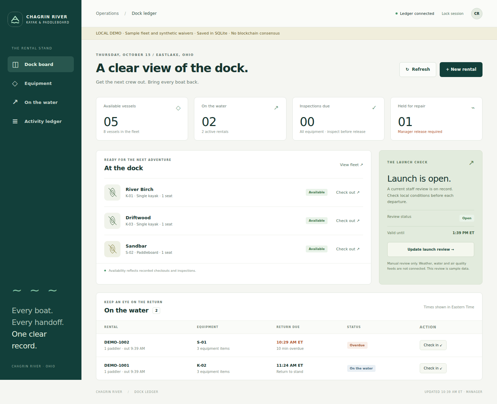

# Chagrin River · blockchainkayak

A staff operations ledger for **Chagrin River Kayak and Paddleboard**: equipment custody, checkouts, returns, inspections, launch reviews, and transaction history.

Inspired by the asset provenance pattern in [IBM/blockchainbean2](https://github.com/IBM/blockchainbean2). This is a new implementation using the Fabric Gateway client, rather than a copy of the archived Fabric 1.4 / IBM Blockchain Platform beta application. There is no IBM affiliation or endorsement.

**Version 0.1.0 is a working development starter.** The default mode is a local SQLite demonstration with synthetic equipment and waivers. A separate Fabric adapter and deployable contract are included. Starting the demo does not start a blockchain.



[Mobile view](docs/images/mobile.png)

## Try the stand workflow

Use Node.js **22.13+** (Node 24 recommended).

```bash
git clone https://github.com/djlacavera21/blockchainkayak.git
cd blockchainkayak
npm ci
npm run demo
```

Open the local link printed in your terminal. Its URL fragment contains a temporary manager key, which the browser removes after reading it. The key stays in that browser tab's session storage until you lock the session. Do not share the link.

The demo supplies a fictional fleet of eight vessels, twelve PFDs, and twelve paddles. It includes two active rentals, one overdue rental, and a maintenance hold. These are **not the business's inventory, rental records, prices, or actual operating conditions**. Hours, rates, address, and customer data have deliberately not been invented.

Demo data persists at `data/demo.sqlite`. Stop the server and remove that file and its `-wal`/`-shm` companions to reset the sample. A review that expires while the server is stopped remains expired after restart; record a new review to reopen launches.

## Included workflows

| Staff task | Recorded behavior |
| --- | --- |
| Add equipment | Manager registers a kayak, tandem kayak, paddleboard, PFD, or paddle; inspection is required before use. |
| Inspect | Pass all three checks to make equipment available. Failed inspections hold equipment for maintenance. |
| Open / hold / close launch | Manager records a decision with a reason and expiry, up to twelve hours. New departures fail closed without a current open review. |
| Check out | Assign available equipment, enough vessel seats, one PFD and paddle per paddler, briefing and fit confirmations, an opaque renter reference, and a waiver digest. |
| Return | Release all equipment from the rental; damaged items go to maintenance and other items require inspection. |
| Repair / retire | Only a manager can release a maintenance hold; retirement is terminal in this version. |
| Audit | Query active rentals, look up returned rentals, page through equipment histories, and export the current snapshot. |

The UI assigns one vessel per checkout; the contract also supports multiple vessels in one rental. Tandems have two seats. Other vessel types have one. Inspection freshness is fixed at 24 hours in this starter and every return requires another inspection. Adjust these business rules only after the operator confirms them.

## Use Hyperledger Fabric

See [docs/FABRIC.md](docs/FABRIC.md) for the Docker test-network setup, role enrollment, deployment, and an actual-network smoke test.

```bash
# After installing official Fabric samples, binaries, and images:
export FABRIC_SAMPLES_PATH=/absolute/path/to/fabric-samples
npm --prefix chaincode ci
npm run fabric:up
npm run fabric:deploy
npm run fabric:enroll
npm run fabric:start
```

Fabric mode connects over TLS, uses a different certificate for each configured role, waits for transaction commit, and stops on configuration or connection failure. It never falls back to SQLite. The contract enforces `kayak.role` certificate attributes and the packaged operator MSP policy independently of HTTP permissions.

## Validate

```bash
npm ci
npm --prefix chaincode ci
npm run check
npm test
npx playwright install chromium
npm run test:browser
# Writes synthetic records only to an isolated, explicitly configured test network:
npm run test:fabric
```

Unit/integration tests cover custody rules, concurrent demo checkouts, rollback, stale launch reviews, inspection requirements, role enforcement, idempotency, persistence, HTTP validation, and deterministic contract results using a mocked Fabric stub. Browser checks cover desktop and mobile and the main staff workflow. **A mocked stub does not establish that network deployment or Fabric consensus works**; `test:fabric` provides a separate real-network check.

GitHub Actions runs the unit/API/browser checks. The separate **Fabric network smoke test** workflow builds an isolated Docker network on relevant pushes to main and can also be run manually from the Actions tab.

## Architecture and operating scope

The browser calls a same-origin Node HTTP API. The API chooses either SQLite or Fabric Gateway. Both adapters execute the same rental domain rules. The Fabric contract persists equipment, rentals, active-rental indexes, operation receipts, events, and equipment history as separate world-state keys; checkout reads and writes every assigned equipment key. Fabric's MVCC validation rejects conflicting committed updates.

```text
public/         Staff dashboard, forms, local waiver hashing
server/         HTTP access control, SQLite demo and Fabric Gateway adapters
chaincode/      Self-contained deployable Fabric contract and rental rules
scripts/        Checks, browser test, test-network deployment and enrollment
test/           Domain, HTTP and mocked-contract tests
docs/           Fabric setup, API, data handling and deployment notes
```

This version does not collect payments, reservations, waiver signatures, customer names, contacts, medical information, or live environmental readings. Hashing a signed waiver file happens in the browser; the file is not uploaded. A digest alone does not prove consent, validate a waiver, or replace the signed original. Keep those originals and the mapping from a random renter reference to private records in the operator's approved system.

Role keys and role certificates are shared service identities in v0.1; audit entries identify the role identity, not individual employees. See [docs/OPERATIONS.md](docs/OPERATIONS.md) before introducing real staff or customer workflows. This repository does not authorize deployment at the employer's stand.

Further reference: [Fabric Gateway](https://hyperledger-fabric.readthedocs.io/en/latest/gateway.html), [Fabric test network](https://hyperledger-fabric.readthedocs.io/en/latest/test_network.html), [API and data model](docs/API.md).
